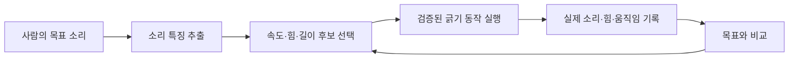

# Nero 긁기 소리 연구: 좌표 이동 다음부터 소리 재현까지

작성일: 2026-11-10. 현재 프로젝트의 Nero 제어 코드와 아래 원문 자료를 바탕으로 제안하는 실험 계획입니다. 장비는 아직 구매 전이며, 접촉 실험이나 새로운 구동은 실행하지 않았습니다. 아래 횟수와 수집 설정은 시작용 제안이며 검증된 최적값이 아닙니다.

## 1. 첫 목표와 최종 목표

첫 목표는 **한 가지 표면을 한 가지 팁으로 반복해서 긁으면서 소리·실제 움직임·누르는 힘을 함께 기록하는 것**입니다. 그다음 같은 도구를 사람이 사용한 결과와 비교합니다.

최종 목표는 다음과 같이 정의하면 실험과 학습으로 연결하기 쉽습니다.

> 재질과 도구가 주어진 상태에서 목표 소리를 입력하면, 제한된 범위의 속도·누르는 힘·이동 길이·방향을 선택하고 로봇으로 비슷한 소리를 재현한다.

소리 하나에서 원래의 7개 관절 움직임을 유일하게 알아내는 것은 일반적으로 불가능합니다. 서로 다른 행동이 비슷한 소리를 낼 수 있기 때문입니다. 먼저 비슷한 소리를 만드는 행동을 찾고, 필요하면 그중 힘이나 이동량이 작은 행동을 고르는 문제로 다룹니다.



## 2. 현재 코드로 가능한 것과 추가할 것

| 현재 확인한 기능 | 연구를 위해 추가할 기능 |
| --- | --- |
| 상태·관절각·플랜지 위치 조회 | 한 번의 실험 전체를 파일로 기록하는 로거 |
| `nero_move_to.py`로 절대 XYZ 직선 이동 | 여러 지점으로 구성된 반복 동작과 실험 ID 관리 |
| `nero_move_linear.py`로 작은 상대 이동 | 접근 → 접촉 → 긁기 → 들어 올림 → 공중 복귀 순서 |
| 신선한 CAN 피드백 확인 | 오디오·힘 센서·로봇 기록의 시간 정렬 |
| 플랜지 좌표 기준 이동 | 실제 팁 끝의 위치와 시편 표면 기준 좌표계 보정 |

코드상 중요한 제한은 다음과 같습니다.

- 현재 XYZ는 **플랜지, 즉 도구 장착면** 기준입니다. 팁을 달면 팁 끝까지의 위치·방향 차이를 반영해야 합니다. SDK의 `set_tcp_offset()` / `get_tcp2flange_pose()`를 이용할 수 있지만 기존 `move_l()` 입력이 자동으로 팁 좌표로 바뀌는 것은 아닙니다. 변환을 적용하는 별도 계층이 필요합니다.
- 현재 `set_speed_percent(5)`는 **속도 비율 5%**입니다. 5mm/s라는 뜻이 아닙니다. 위치와 시각 기록으로 실제 팁 이동 속도를 추정해 조건을 보정해야 합니다.
- 현재 펌웨어 1.12의 `get_motor_states().velocity`는 SDK에서 0으로 처리됩니다. 이 값을 실측 속도로 사용하면 안 됩니다. [펌웨어별 차이](firmware_reference.md)를 참고하세요.
- `move_l()`은 위치 이동 명령입니다. **“표면에 1N으로 누르며 이동”하는 힘 제어가 구현되어 있지는 않습니다.** 힘 센서를 붙여 기록하는 것과 힘을 자동으로 일정하게 유지하는 제어는 별도 개발입니다.
- `move_mit()`은 관절 수준 제어입니다. 바로 팁의 접촉력을 지정하는 기능으로 사용하면 안 됩니다. 초기 실험은 기계적 탄성과 힘 측정부터 구성합니다.
- 현재 이동 스크립트는 이동 명령 전송 후 예외가 발생하면 전자 급정지를 요청할 수 있습니다. 이 동작과 disable/reset 때의 자세 변화를 고려해 접촉 장치의 지지·탄성·과부하 대책을 설계해야 합니다. 현재 공중 이동용 스크립트를 그대로 표면 안쪽으로 내려 보내는 방식으로 접촉을 시작하지 않습니다.

## 3. 장비를 준비하는 순서

예산이 확정되지 않았으므로 단계별 구성을 제안합니다. 구체적인 모델은 팁·시편 크기·필요 힘 범위·Windows 데이터 수집 지원을 확인한 뒤 선정합니다. 국내 가격은 확인하지 않았습니다.

| 우선순위 | 장비 | 역할과 선택 기준 |
| --- | --- | --- |
| 처음부터 | 교체 가능한 끝이 둥근 팁과 홀더 | 처음에는 도구 한 종류. 사람도 같은 팁을 사용할 수 있게 손잡이 준비. 형상·재질·마모 상태 기록 |
| 처음부터 | 스프링 등 탄성이 있는 장착부 | 작은 위치 오차가 큰 접촉력으로 바뀌는 것을 줄임. 탄성이 있다고 힘이 자동으로 일정해지는 것은 아님 |
| 처음부터 | 시편 고정 지그 | 재질을 교체해도 위치·높이·고정 상태를 재현. 고정 방식 자체도 소리를 바꾸므로 기록 |
| 접촉 데이터 수집 전 | 수직 하중용 로드셀 + 증폭기/DAQ | 시편 아래에서 누르는 힘을 N으로 측정. 수평 마찰력의 영향을 줄이는 기구 설계와 영점·하중 보정 필요 |
| 처음부터 | 마이크 + 고정 스탠드 | 사람이 듣는 공기 전달 소리 기록. 표면과의 거리·방향·녹음 게인 고정 |
| 권장 | 아날로그 입력 2개 이상의 오디오 인터페이스 | 공기 마이크와 접촉 마이크를 같은 장치에서 녹음하면 두 오디오 채널의 시간 정렬이 쉬움 |
| 권장 | 접촉 마이크 + 호환 프리앰프 | 시편 진동을 추가 기록. 수동 피에조는 입력 임피던스와 증폭기 호환 확인. 부착 위치도 조건에 포함 |
| 나중에 | 6축 힘/토크 센서 | 수직력·마찰력·토크를 함께 분석하거나 고도화한 제어를 할 때 검토 |
| 선택 | 고정 카메라 | 접촉 상태·미끄러짐·실패 원인을 확인하는 보조 기록 |

오디오 인터페이스의 예로 [Scarlett 2i2 4세대 공식 사양](https://userguides.focusrite.com/hc/en-gb/articles/19640392541202-Scarlett-2i2-4th-Gen-Specifications)이 있습니다. 물리적 아날로그 입력 2개와 24bit/48kHz 녹음 구성을 확인할 수 있습니다. 특정 제품을 필수로 정한 것은 아닙니다. 자동 게인·음색 보정 기능은 측정 시 끄고 일정한 설정을 사용합니다.

6축 센서의 예는 [ATI Mini45 공식 자료](https://www.ati-ia.com/products/ft/ft_models.aspx?id=Mini45)에서 볼 수 있습니다. 초기 단계에서는 단축 하중 측정으로 시작할 수 있으며, 6축 제품은 필요한 힘 범위·분해능·질량·장착 어댑터·수집 장치까지 함께 검토합니다. 학습용 GPU보다 실험 장치와 기록 품질을 먼저 확보하는 편을 권합니다.

## 4. 단계별 진행과 다음 단계로 넘어가는 조건

| 단계 | 할 일 | 결과물 / 넘어가는 기준 |
| --- | --- | --- |
| 1. 실험 정의 | 한 가지 팁·시편·긁는 방향 결정. 사람이 같은 팁을 잡는 방법도 준비 | 실험 장치 그림, 조건 목록, 부품 목록 |
| 2. 좌표 보정 | 팁 끝 TCP 보정. 표면의 여러 점을 측정해 표면 평면과 진행 방향 정의 | 팁과 표면 기준 좌표를 일관되게 표시 |
| 3. 비접촉 반복 | 표면 위에서 왕복 경로를 실행하고 위치·시각·소리 기록 | 시작 위치·경로 재현성과 실제 속도 확인, 모터 소음 확보 |
| 4. 접촉 검증 | 힘 센서 영점·하중 보정, 탄성 장착부 시험, 짧은 한 방향 스트로크 | 힘과 접촉 시점이 기록되고 과도한 하중 없이 반복 가능 |
| 5. 첫 데이터 | 한 재질·한 팁·한 조건으로 10회 반복 | 녹음 잘림·왜곡·누락 없이 반복 변동을 설명 가능 |
| 6. 조건 확장 | 속도·누르는 힘 수준·재질을 바꿔 수집 | 조건별 실측값과 소리를 연결한 데이터셋 |
| 7. 사람 비교 | 같은 팁·시편·녹음 환경에서 사람 데이터 수집 | 도구 차이를 줄인 사람/로봇 비교 |
| 8. 소리로 행동 선택 | 목표 소리와 가까운 기존 실험을 찾아 해당 조건 재현 | 학습 없이도 작동하는 첫 소리 재현 시스템 |
| 9. 학습과 개선 | 행동→소리 예측 모델과 제한된 조건 탐색 결합 | 미리 녹음하지 않은 조건에서도 재현 성능 검증 |

일정은 장착부 제작과 계측 연결에 따라 달라집니다. 기간보다 각 단계의 기록과 재현성을 기준으로 진행합니다.

## 5. 긁기 동작을 정의하는 법

표면 기준으로 두 개의 방향을 구분합니다.

- 표면을 따라 움직이는 방향: 긁는 진행 방향.
- 표면에 수직인 방향: 누르는 방향.

시편이 기울어져 있으면 로봇 베이스의 Z방향과 누르는 방향은 다릅니다. 평면을 정하려면 최소 세 개의 일직선상에 있지 않은 점이 필요하며, 여러 점을 이용하면 보정 오차를 확인하기 쉽습니다.

한 번의 실험은 **공중 접근 → 접촉 및 초기 하중 확인 → 한 방향 긁기 → 팁 들어 올리기 → 공중 복귀**로 구분합니다. 돌아오는 길까지 접촉하면 반대 방향의 긁기 소리가 섞입니다.

첫 경로 확인은 기존 거리 제한 안의 짧은 구간, 예를 들어 10mm부터 검토할 수 있습니다. 다만 너무 짧으면 가속·감속 구간이 대부분이라 소리 비교가 어렵습니다. 이후 검증을 거쳐 경로를 늘리고 중간의 안정적인 구간을 분석합니다. 현재 `nero_move_to.py`의 기본 거리 제한은 20mm이므로 긴 실험 경로는 검증 후 별도 설계합니다.

실험에서 바꿀 행동은 처음에 다음 네 가지로 제한합니다.

| 행동 변수 | 기록할 실제 값 |
| --- | --- |
| 진행 속도 | 팁 위치와 시각으로 추정한 mm/s 및 시간 변화 |
| 누르는 힘 수준 | 센서로 측정한 수직력 N의 평균·변동·최댓값 |
| 스트로크 길이 | 실제 접촉하며 이동한 길이 mm |
| 도구 각도 | 표면에 대한 팁의 각도 |

처음에는 길이·각도를 고정하고 속도·힘 수준만 바꿉니다. 수동 탄성 장치에서는 설정한 초기 하중이 이동 중 변할 수 있으므로 **실측 힘을 반드시 함께 기록**합니다. 모든 재질에 공통으로 적용할 안전한 힘 수치를 임의로 정하지 않습니다.

## 6. 녹음과 시간 정렬

시작 설정으로 원본 WAV 48kHz/24bit, 동작 전후 0.5~1초의 여유 녹음을 제안합니다. Windows에서 실제 사용할 녹음 프로그램/라이브러리의 장치·드라이버 지원은 장비 선정 후 확인합니다.

- 자동 게인·노이즈 제거·음성 강조를 끕니다. 원본을 보존합니다.
- 마이크 위치, 시편 고정, 게인, 방 상태를 기록합니다. 사람과 로봇 실험에서도 유지합니다.
- 방 소음, 같은 경로의 공중 이동, 정지 접촉을 따로 녹음합니다. 모델이 긁기 대신 모터 소음만 구별하는지 확인할 기준입니다.
- 접촉 마이크는 물체 진동, 공기 마이크는 방으로 방사된 소리를 측정합니다. 둘을 같은 의미의 소리로 취급하지 않습니다.
- 소리 크기를 모두 똑같이 정규화하면 누르는 힘에 따른 차이까지 지워질 수 있습니다. 크기와 음색의 비교를 나누고 원본을 남깁니다.

**명령을 보낸 시각은 실제 접촉 시각과 다릅니다.** 오디오 장치, 힘 DAQ, CAN 피드백은 서로 다른 시계를 쓸 수 있습니다. 우선 모든 원시 시각과 오디오 샘플 위치를 저장하고, 여러 기록에서 확인 가능한 시작·끝 이벤트로 시간 차이와 드리프트를 확인합니다. 정밀 실험은 공통 트리거를 지원하는 구성을 검토합니다.

기존 `nero_feedback_clock.py`는 Windows의 CAN 수신 시각 비교 문제를 다룹니다. 오디오와 힘 센서까지 동기화해 주는 기능은 아닙니다. CAN의 여러 메시지로 조립되는 관절/위치 데이터도 완전히 동시 측정된 값으로 가정하지 않습니다.

## 7. 첫 수집량과 실험 설계

장치 검증 후 첫 접촉 데이터는 한 재질·한 팁·한 조건으로 다음 정도를 제안합니다.

| 종류 | 제안 횟수 |
| --- | ---: |
| 실제 긁기 | 10 |
| 같은 경로 공중 이동 | 5 |
| 움직임 없는 접촉 | 5 |
| 방 배경 소음 | 5 |

여기서 확인할 것은 학습 정확도가 아니라 녹음 품질, 힘 변화, 실제 속도, 반복 간 차이입니다. 접촉 시점이 안 보이거나 반복마다 하중이 크게 달라지면 장치부터 고칩니다.

다음 탐색 실험의 예는 **재질 3종 × 속도 3수준 × 초기 하중 3수준 × 반복 5회 = 로봇 135회**입니다. 길이·각도·도구·마이크는 고정합니다. 이 수량은 초기 경향을 확인하기 위한 제안이며, 딥러닝에 충분하다는 뜻은 아닙니다.

조건 순서는 섞고, 표면의 사용 위치·마모·팁 상태를 기록합니다. 같은 자리를 계속 긁어 표면이 변하는 효과와 재질 차이를 혼동하지 않도록 합니다. 다른 날에 반복한 데이터도 확보합니다.

사람 데이터는 로봇과 별도로 셉니다. 처음에는 한 사람이 같은 팁을 잡고 같은 힘/속도 범위를 시도하고, 실제 측정된 값을 비교합니다. 이후 여러 사람으로 확장합니다. 맨손·손톱과 로봇 팁을 비교하는 실험은 접촉 재료와 형상까지 달라지는 별도 단계입니다.

## 8. 저장할 파일과 항목

권장 구조의 예입니다. 아직 이 형식의 수집 프로그램을 구현한 것은 아닙니다.

```text
data/scratch/<session_id>/<trial_id>/
  audio.wav       # 공기/접촉 마이크, 채널 정의 별도 기록
  robot.csv       # 관절각, 플랜지/팁 위치, 원시 시각, 수신 상태
  force.csv       # 하중 및 원시 시각, 영점/교정 정보
  events.json     # 접근/접촉/긁기/이탈/중단 시점과 시간 정렬 정보
  meta.json       # 시편·도구·조건·사람/로봇·품질 정보
```

메타데이터에는 재질명뿐 아니라 **개별 시편 ID**, 도구 ID와 끝 형상, 고정 방식, 사람 ID, 날짜/세션, 명령값과 실측값, 마이크 위치/게인, 센서 교정 버전, 오디오 잘림·피드백 누락·중단 여부를 넣습니다. 사람이 긁을 때도 도구 움직임을 측정할 방법이 필요합니다. 처음에는 고정 카메라와 표식을 이용한 속도 추정 등을 검토합니다.

## 9. 학습을 시작하는 순서

### A. 먼저 소리가 조건을 구별하는지 확인

파형, 시간에 따른 소리 세기, 주파수 분포, 로그 멜 스펙트로그램을 봅니다. 재질·속도·힘을 바꿨을 때 반복 변동보다 구별되는 변화가 있는지 확인합니다. 간단한 재질 분류나 속도/힘 회귀는 데이터 품질을 확인하는 보조 과제로 사용할 수 있습니다.

### B. 기존 녹음에서 비슷한 소리를 찾고 재현

목표 소리의 특징과 가장 가까운 실험을 검색하고 그때의 행동 조건을 실행합니다. 예를 들어 “이 소리는 같은 재질의 중간 속도·낮은 하중 조건과 가장 비슷했다”는 식입니다. 새로운 신경망을 학습하지 않고 만들 수 있는 첫 역방향 시스템입니다. 같은 조건을 재실행해도 소리가 완전히 같지는 않으므로 여러 번 검증합니다.

### C. 행동으로 소리를 예측하는 모델

입력은 재질·도구·실측 속도·힘·길이·각도, 출력은 소리 특징으로 둡니다. 적은 데이터에서는 랜덤 포레스트나 가우시안 프로세스 등 작은 모델부터 비교할 수 있습니다. 먼저 일반 PC로 시작합니다.

이 모델에 여러 행동 후보를 넣어 목표 소리와 가까울 것으로 예상되는 조건을 고릅니다. 선택 범위는 실제 검증한 조건 안으로 제한하고 로봇에서 다시 녹음해 확인합니다. 이렇게 하면 소리에서 행동을 바로 예측하는 복잡한 모델보다 오류 원인을 해석하기 쉽습니다.

### D. 데이터가 쌓이면 소리→행동 모델

소리 표현을 학습한 뒤 재질·도구 정보를 함께 입력하여 행동 조건을 예측합니다. 정답 행동이 하나라는 가정보다 여러 후보를 내거나, 소리 오차와 힘/동작 비용을 함께 고려해 선택하는 방법을 검토합니다.

### E. 반복 실행하며 개선

처음에는 **한 번 긁기 → 소리 비교 → 다음 실행의 조건 수정**으로 진행합니다. 한 번의 긁기 도중 실시간으로 힘과 소리를 조절하는 단계는 센서 지연·제어 주기·접촉 안정성을 확인한 뒤 진행합니다. 강화학습은 이 기반과 제한 조건을 만든 이후에 검토할 선택지입니다.

## 10. 성공 여부를 판단하는 방법

- 목표와 결과의 소리 세기 변화, 주파수 분포, 지속 시간 등을 따로 비교합니다. 무작위성이 있는 마찰 소리를 파형의 샘플별 오차 하나로만 평가하지 않습니다.
- 시간축을 맞추는 DTW 같은 방법을 쓸 때는 실제 길이·타이밍 오차도 별도 보고합니다. 시간축 보정이 속도 차이를 가릴 수 있습니다.
- 무작위 행동, 기존 녹음 최근접 검색, 학습한 방법을 같은 목표에서 비교합니다.
- 사람이 같은 행동을 반복했을 때의 차이와 로봇 반복 간 차이를 기준으로 결과를 해석합니다. 익명 청취 비교도 병행합니다.
- 같은 녹음에서 자른 조각을 학습/평가 양쪽에 넣지 않습니다. 실험 단위로 분리하고 다른 날·시편·사람 데이터에서 검증합니다.
- 새로운 재질에도 된다고 주장하려면 그 재질 전체를 학습에서 제외한 평가가 필요합니다. 처음에는 알려진 재질·도구 안의 재현을 목표로 합니다.

## 11. 참고할 실제 연구

- [That Sounds Right: Auditory Self-Supervision for Dynamic Robot Manipulation, CoRL 2023](https://proceedings.mlr.press/v229/thankaraj23a.html): 행동과 소리의 관계를 학습해 목표 소리에 맞는 동작을 선택한 관련 사례입니다. 소수의 동작 매개변수로 문제를 구성하는 방향을 참고할 수 있습니다. Nero 긁기 제어를 바로 제공하는 코드는 아닙니다.
- [Tactile, Audio, and Visual Dataset During Bare Finger Interaction with Textured Surfaces, Scientific Data 2025](https://www.nature.com/articles/s41597-025-04670-0): 사람의 표면 탐색에서 위치/속도·하중·소리·진동을 함께 수집한 연구입니다. 사람 비교 실험의 측정 항목과 프로토콜을 참고하기 좋습니다.

## 12. 지금 할 다음 작업

1. 같은 팁을 사람과 로봇이 사용할 첫 실험을 정하고 팁·탄성 홀더·시편 지그를 설계합니다.
2. 마이크/인터페이스와 수직 하중 센서/DAQ를 연결 방식까지 포함해 선정합니다.
3. 로봇을 움직이지 않는 녹음·힘·위치 로거부터 만들고 누락과 시간 정렬을 확인합니다.
4. 공중 반복 경로를 기록해 실제 속도와 모터 소음을 확인합니다.
5. 장착·좌표·하중 검증 후 한 재질 10회 긁기 실험으로 넘어갑니다.

첫 연구 산출물은 **“한 재질에서 행동 조건과 소리가 짝지어진, 재현 가능한 작은 데이터셋”**입니다. 이것이 있어야 사람과의 비교와 소리 기반 행동 선택을 같은 기준으로 평가할 수 있습니다.
